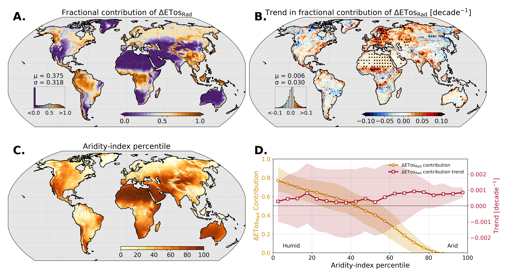
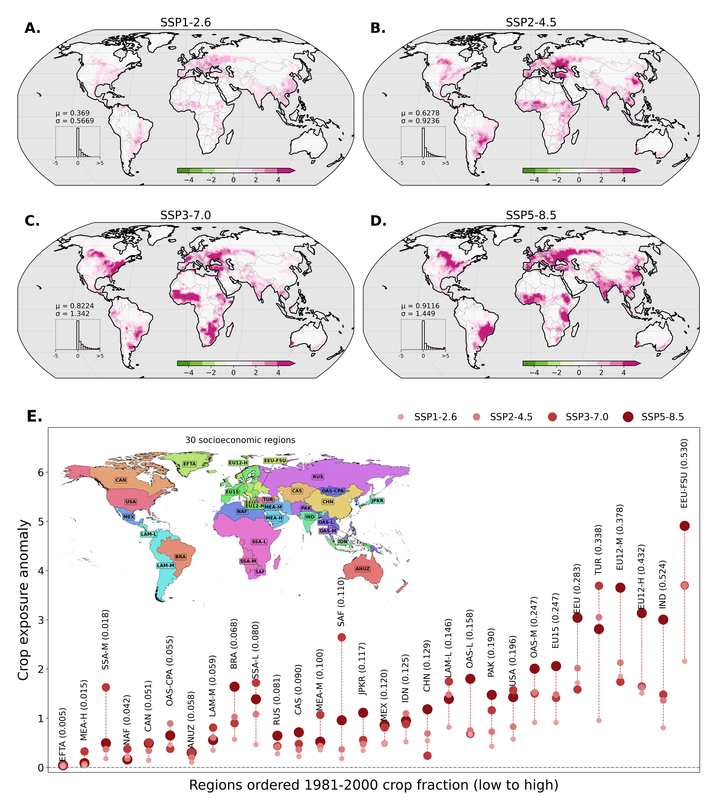
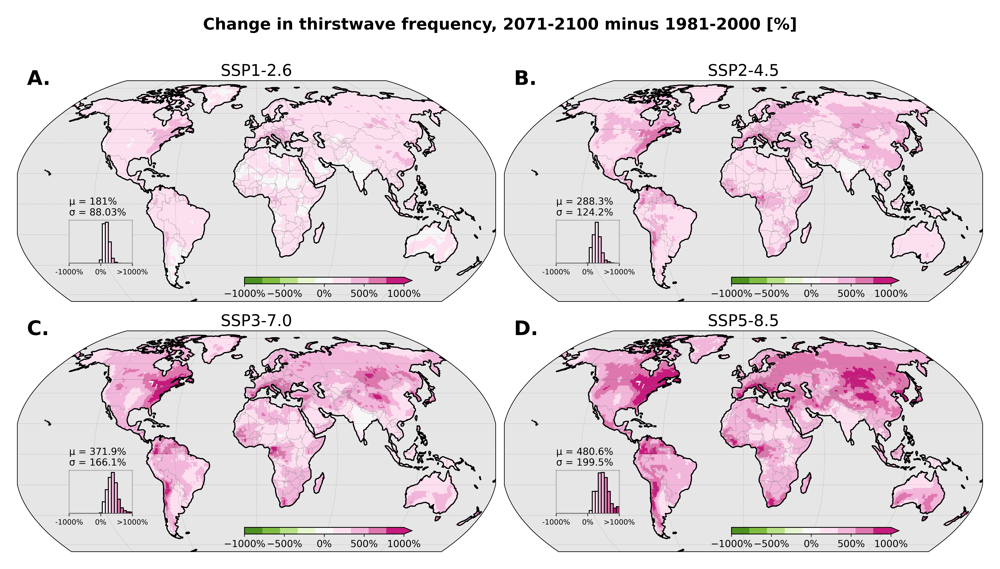
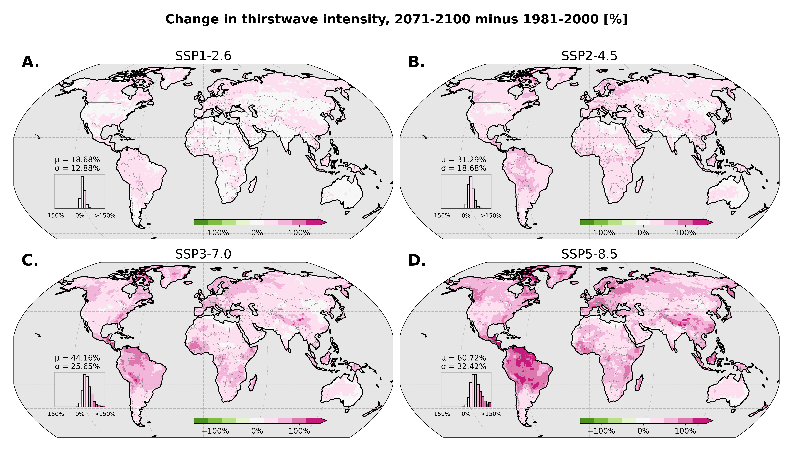
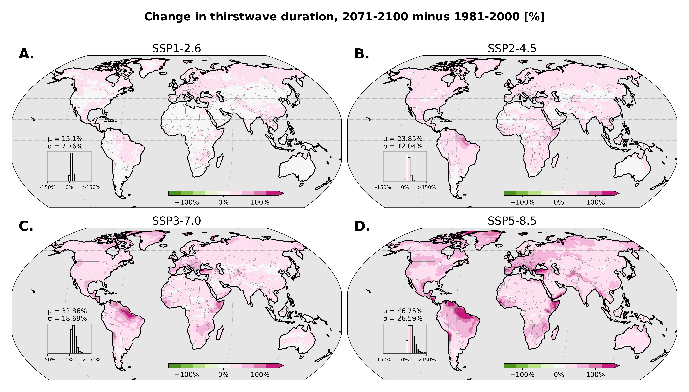
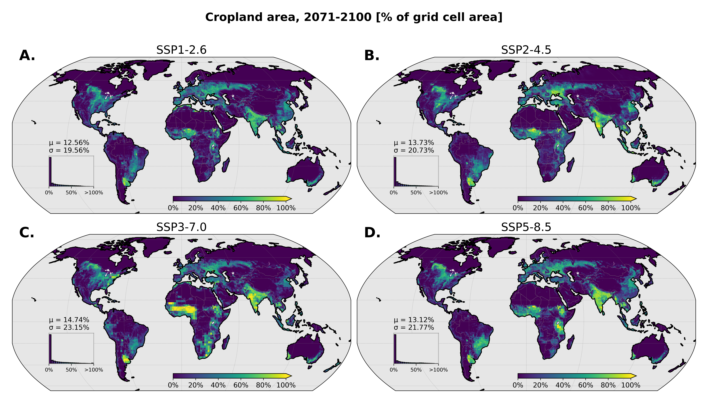
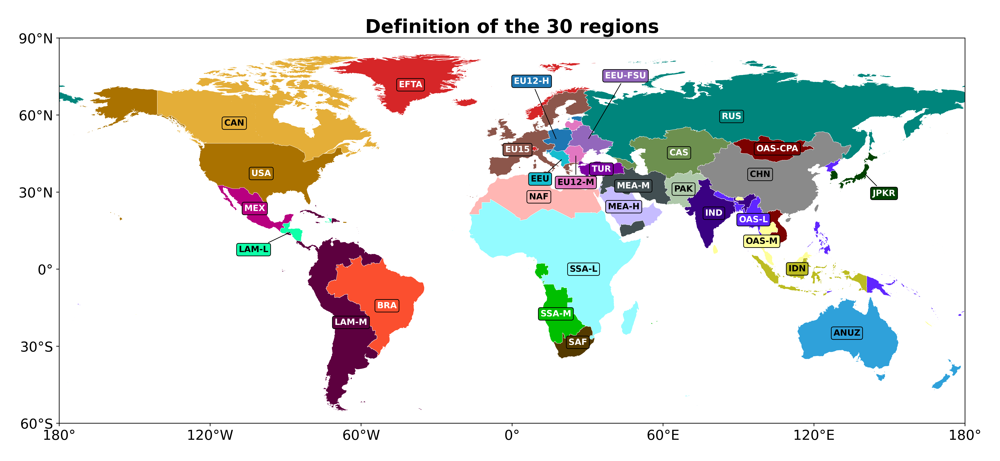

# Figures

#TODO: Update figure title and caption when I know the final figure captions

This folder contains the **Python notebooks (`.ipynb`) used to create the figures**, and the resulting figures in **PNG** (`png/`) and **PDF** (`pdf/`) format.

Notebooks are named after the figure they produce (e.g. `Figure2.ipynb`, `FigureS3.ipynb`). Notebooks ending in `_left`, `_right`, `_upper`, `_top` or `_bottom` create individual panels, and `*_merge_panels.ipynb` notebooks assemble them into the final figure. They read the derived data described in the [main README](../README.md) and use the helpers in [`plot_utils.py`](../CMIP6/plot_utils.py).

Click a title below to expand the figure.

## Main figures

<b>Figure 1 – Thirstwave detection, metrics, and global patterns</b>

 

**A–B.** Example of thirstwave detection at one grid cell and schematic of the metrics (intensity, duration). **C–H.** Global maps of frequency, intensity and duration, and their trends.

<b>Figure 2 – Radiative contribution to thirstwave anomalies</b>

 

**A–B.** Fractional contribution of the radiative term (ΔETosRad) and its trend. **C–D.** Aridity-index percentile and dependence of the radiative contribution and its trend on aridity.

<b>Figure 3 – Projected changes in thirstwave characteristics</b>

 

**A, C, E, G.** Time series (1980–2100) of frequency, intensity, duration and radiative contribution for historical, SSP1-2.6 to SSP5-8.5 and ERA5. **B, D, F, H.** Corresponding maps of change.

<b>Figure 4 – Crop exposure to thirstwaves</b>

 

**A–D.** Crop exposure anomaly maps for SSP1-2.6 to SSP5-8.5. **E.** Crop exposure anomaly by socioeconomic region and scenario, regions ordered by 1981–2000 crop fraction.

## Supplementary figures

<b>Figure S3 – 90th-percentile ETos threshold per model</b>

 

Growing-season 90th-percentile threshold (1981–2000) for each of the 8 GCMs.

<b>Figure S4 – ETos climatology per model</b>

 

Growing-season ETos climatology (1981–2000) for each of the 8 GCMs.

<b>Figure S5 – Change in thirstwave frequency</b>

 

Change in frequency, 2071–2100 minus 1981–2000 (%), for each SSP.

<b>Figure S6 – Change in thirstwave intensity</b>

 

Change in intensity, 2071–2100 minus 1981–2000 (%), for each SSP.

<b>Figure S7 – Change in thirstwave duration</b>

 

Change in duration, 2071–2100 minus 1981–2000 (%), for each SSP.

<b>Figure S8 – Cropland area</b>

 

Cropland area in 2071–2100 (% of grid cell area) for each SSP.

<b>Figure S9 – Definition of the 30 regions</b>

 

Socioeconomic regions used in Figure 4E.

